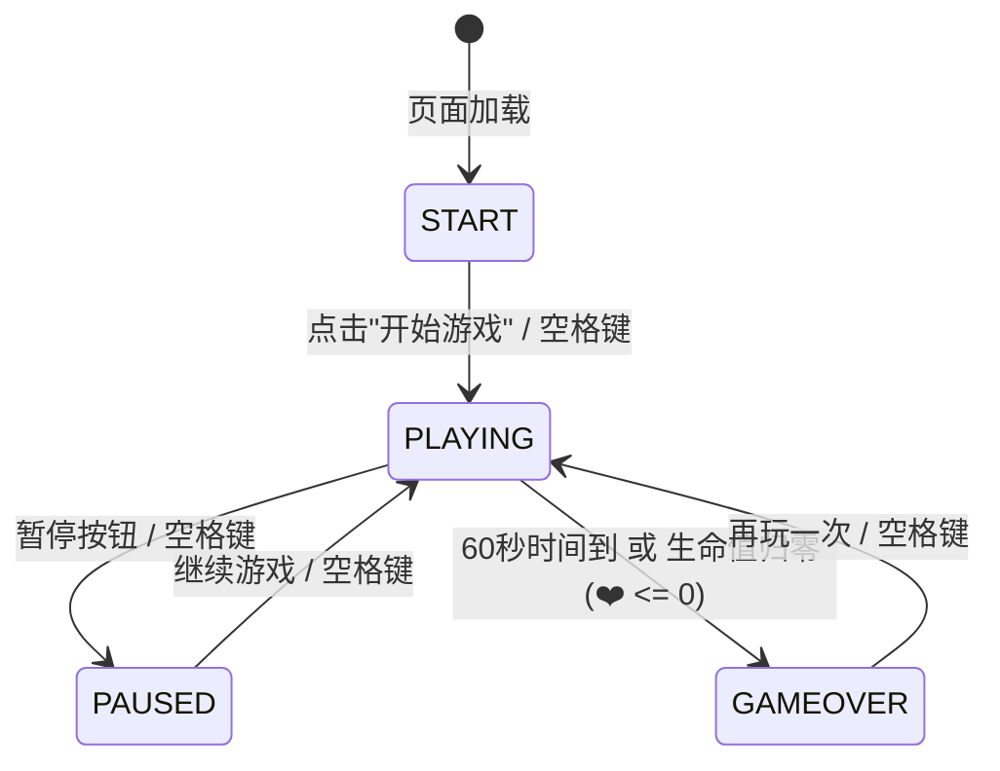

# 🐾 萌喵甜点大作战 (Sweet Cat Bakery) 开发者指南

本文档面向希望了解游戏架构、修改玩法数值、进行二次开发或将游戏部署至生产环境的开发者。

---

## 目录
1. [技术选型与设计理念](#1-技术选型与设计理念)
2. [工程目录结构](#2-工程目录结构)
3. [多端与大屏适配规范](#3-多端与大屏适配规范)
4. [核心系统架构解析](#4-核心系统架构解析)
   - [4.1 游戏循环与有限状态机 (FSM)](#41-游戏循环与有限状态机-fsm)
   - [4.2 角色与程序化矢量渲染管线](#42-角色与程序化矢量渲染管线)
   - [4.3 道具与危险障碍物生成体系 (11种道具)](#43-道具与危险障碍物生成体系-11种道具)
   - [4.4 危险警示指示器 (Hazard Warning Cues)](#44-危险警示指示器-hazard-warning-cues)
   - [4.5 连击里程碑与掉落中断惩罚机制](#45-连击里程碑与掉落中断惩罚机制)
   - [4.6 疾跑冲刺 (Dash) 机制](#46-疾跑冲刺-dash-机制)
   - [4.7 萌喵成就系统 (Achievements)](#47-萌喵成就系统-achievements)
   - [4.8 纯代码合成音频引擎 (Web Audio API)](#48-纯代码合成音频引擎-web-audio-api)
   - [4.9 战绩海报生成器 (Poster Generator)](#49-战绩海报生成器-poster-generator)
5. [本地服务器与端口配置](#5-本地服务器与端口配置)
6. [二次开发扩展实战](#6-二次开发扩展实战)
7. [生产环境部署方案](#7-生产环境部署方案)

---

## 1. 技术选型与设计理念

- **无第三方运行时依赖**：原生 ES6+ JavaScript + HTML5 Canvas 2D + Web Audio API + 纯 CSS3。
- **程序化矢量美学 (Procedural Vector Art)**：
  - 角色、甜点、道具、警示徽标与表情均直接使用 Canvas 2D API 动态绘制，不依赖任何外部 PNG/JPG 图片。
  - **优势**：自适应高分屏（4K/2K/Retina Display），在任何 DPI 缩放比例下边缘均清晰锐利，无网络图片加载延迟与跨域 404 风险。
- **程序化声音合成 (Procedural Audio Synthesis)**：
  - 音效与背景八音盒旋律均使用 Web Audio API 的振荡器（Oscillator）与增益节点（GainNode）实时合成。
  - **优势**：零音频文件体积，无需担心音频预加载或格式兼容性，并可基于连击数（Combo）实时进行音阶递增调度。
- **响应式与多输入支持**：全屏自适应，支持 PC 高清屏、平板 Pad 及手机触摸滑动，支持按键冲刺与触控按键。

---

## 2. 工程目录结构

```text
httpserver/
├── index.html        # 主页面骨架：DOM HUD 仪表盘、Buff 状态栏、三层弹窗 Overlay、图鉴与海报弹窗
├── style.css         # 视觉样式：马卡龙粉彩配色规范、全屏适配、响应式栅格、果冻按钮与 Toast 动效
├── i18n.js           # 中英双语国际化字典引擎：默认英语、支持动态一键切换与参数插值
├── game.js           # 游戏核心逻辑：主循环、角色状态、掉落物理、碰撞检测、道具 Buff、海报渲染
├── audio.js          # Web Audio 声音引擎：音效合成器、八音盒 BGM 节拍调度器
├── server.py         # 本地开发 HTTP 服务器：支持灵活指定端口、自动容灾顺延、禁用缓存
├── README.md         # 玩家上手说明与游玩指南
└── DEVELOPMENT.md    # 开发者完整架构文档与二次开发指南 (本文档)
```

---

## 3. 多端与大屏适配规范

为了彻底解决“PC 高清大屏幕下画面太小”以及“手机端容易误触页面滚动”的问题，游戏采用了自适应多层适配策略：

1. **容器流式尺寸弹性适应**：
   - CSS 容器采用 `width: min(94vw, 680px); height: min(92vh, 880px);`。在 2K / 4K / 1080p 大屏 PC 上，游戏舞台大幅延展，画面宽阔大气；在手机和小屏设备上则自适应占据全屏。
2. **全屏 / 宽屏沉浸模式 (Fullscreen API)**：
   - 顶部导航栏提供了 `⛶` 全屏切换按钮（快捷键 <kbd>F</kbd>）。进入全屏时容器扩展为 `100vw × 100vh`，边框自动平滑归零。
3. **Canvas Retina 动态缩放**：
   - 每次窗口尺寸改变或全屏切换时，`resize()` 会读取真实的 `rect.width` 并乘以 `devicePixelRatio`，物理绘制缓冲区自动重置，避免像素锯齿失真。
   - 角色活动边界自适应延伸至 `[40, this.width - 40]`，甜点掉落范围覆盖整个宽屏视域。
4. **移动端手势优化**：
   - 画布开启 `touch-action: none;`，彻底禁用浏览器的双指缩放和橡皮筋滚动，滑动操作毫秒级响应。
   - 提供右下角悬浮触控冲刺按钮 `mobileDashBtn`，方便移动设备拇指点击。

---

## 4. 核心系统架构解析

### 4.1 游戏循环与有限状态机 (FSM)



### 4.2 游戏模式与限时设计 (Game Modes)

游戏提供了两种挑战模式，玩家可在主界面自由切换：
1. **⚡ 60秒极速挑战模式（默认推荐）**：
   - 每次游戏限时 **1 分钟（60秒倒计时）**。
   - 顶部 HUD 动态显示 `⏱️ 60s` 倒计时；剩余时间小于 10 秒时进入红色呼吸警示状态。
   - 接取 ⏰ 时光怀表除获得 50% 减速效果外，**额外奖励 +5 秒时间**（`timeLeft += 5000`）。
   - 倒计时归零时触发游戏结算，统计最终得分与成就。
2. **💖 经典无尽生存模式**：
   - **不设时间限制**！拥有 3 颗爱心，只要不全部耗尽即可无限挑战，比拼持久生存与极限连击纪录。
   - **🏳️ 主动结算机制 (见好就收)**：避免玩家表现极佳、心心不减却想提前结算退出的尴尬，在暂停界面提供了 `🏳️ 见好就收 (立即结算)` 按钮，并在生存模式运行中的标题栏常驻 `🏳️` 快速结算入口，安全落袋当前得分并归入历史战报。

### 4.3 玩家战绩档案与本地存储系统 (LocalStorage)

游戏充分利用本地存储将玩家数据安全保存在客户端，无任何隐私泄露风险：
1. **战绩档案与生涯历史 (`cute_cat_records`)**：
   - `totalGames`：总游玩对局次数。
   - `totalSweets`：累计捕获的美味甜点总数。
   - `timedBest`：60 秒挑战模式的历史最高得分。
   - `survivalBest`：经典无尽生存模式的历史最高得分。
   - `history`：包含最近 30 场对局的详细阵列（时间戳、模式、最终得分、最高连击、结算原因 `manual_end`/`time_up`/`lives_out`、穿戴饰品）。
2. **对局进度暂存与断点续玩 (`cute_cat_saved_game`)**：
   - 玩家在游戏中随时暂停，点击 `💾 暂存进度 (下次继续)` 即可将当前运行状态（当前得分、剩余生命、连击数、剩余时间毫秒数、游戏模式、当前护盾/磁铁/减速等全部 Buff 状态、装备皮肤、捕获甜点计数）序列化为 JSON 写入本地。
   - 当玩家下次访问游戏时，主界面会自动感应并渲染醒目的恢复卡片，点击 `▶️ 继续上次对局` 即可无损还原所有局内状态！
3. **经济与资产持久化**：
   - `cute_cat_coins`：玩家当前积累的甜点金币余额。
   - `cute_cat_owned_skins` 与 `cute_cat_owned_hats`：玩家已解锁的萌宠品种与饰品列表。
   - `cute_cat_current_breed` 与 `cute_cat_current_hat`：当前出战装备。

### 4.4 🎁 天降神秘小铺 (Sky-Drop Boutique) 与货币经济系统

- **天降小铺触发机制**：
  - 每当全局累计得分突破阶段阈值（初始 300 分，之后每 350 分触发一次），天空中会缓缓飘落一个**带着彩色降落伞的神秘小铺礼盒 🎁**（`speed: 1.8`）。
  - 玩家接住礼盒时，播放欢快星光音效、喷洒礼花粒子，赠送 +25 甜点金币，并自动暂停游戏打开喵喵商城。
- **甜点金币获取途径**：
  - 每次接取美味甜品可按得分比例自动赚取金币（$\text{coins} += \max(1, \lfloor \text{earned} / 12 \rfloor)$）。
  - 接取彩虹星星额外奖励 +15 金币；捕获天降神秘礼盒直接赠送 +25 金币！
- **喵喵商城货架体系 (`shopCatalog`)**：
  - **萌宠皮肤**：纯白棉花糖（免费初始）、阳光大橘猫（120金币）、酷帅黑猫警长（200金币）、治愈小水豚（300金币）。
  - **精美饰品**：粉萌蝴蝶结、甜点大师帽、春日小樱花、璀璨小皇冠、英伦绅士高礼帽、酷炫黑超墨镜。
  - **紧急补给**：满血复活草 (+1 ❤️ 生命)、彩虹护盾球 (立即获得护盾)。

### 4.5 角色与程序化矢量渲染管线

角色形象由 `CuteCatGame.drawCat(x, y)` 动态纯代码矢量绘制：
- **投影层**：半透明粉色柔和椭圆，位置与果冻拉伸挤压状态严格同步。
- **彩虹护盾泡泡 (Rainbow Shield)**：若当前激活护盾，在角色周围渲染流光溢彩的脉冲径向渐变保护罩。
- **萌宠品种差异化渲染**：
  - **🤍 纯白棉花糖 (`white`)**：经典纯白蓬松毛发，粉萌猫耳与灵动粉颊。
  - **🍊 阳光大橘猫 (`orange`)**：温润橘黄底色 (`#FFA726`)，额头生动的橙红虎斑 M 标与脸颊斑纹，奶白色软萌下巴，尾巴带斑纹，搭配清澈翠绿猫眼。
  - **🖤 酷帅黑猫警长 (`black`)**：午夜曜黑礼服毛色 (`#263238`)，胸前优雅纯白衬衫胸兜，黑猫特有的可爱纯白小手套（白爪爪），炯炯有神的金黄璀璨猫眼。
  - **🦭 治愈小水豚君 (`capybara`)**：憨厚的大地棕毛色 (`#8D6E63`)，标志性的方方阔阔大鼻吻部与黑色小鼻孔，惬意平和的禅意眯眯眼（`- -`），在未佩戴饰品时头顶更顶着一颗水灵灵的小蜜桔 🍊！
- **饰品换装图层 (`drawAccessory`)**：
  - 🎀 经典蝴蝶结：双侧飘逸缎带。
  - 👨‍🍳 甜点大师帽：高耸法式主厨褶皱帽。
  - 🌸 春日小樱花：五瓣粉樱与金黄花蕊。
  - 👑 璀璨小皇冠：三峰镂空黄金冠顶缀红宝石。
  - 🎩 绅士高礼帽：黑色丝绸礼帽配深红缎带与金扣。
  - 🕶️ 酷炫黑超墨镜：金丝镜框与镜片高光反光。

### 4.6 道具与危险障碍物生成体系 (12种道具)

道具池由加权随机（Weighted Random Selection）驱动：

| 分类 | 道具 | 基础得分 | 基础速度 | 效果说明 |
| :--- | :--- | :--- | :--- | :--- |
| **美味甜品** | 🍓 草莓 | +10 | 2.3 | 基础常见水果甜点 |
| | 🍩 甜甜圈 | +20 | 2.6 | 淋草莓酱与彩虹糖粒 |
| | 🐟 鲷鱼烧 | +30 | 2.9 | 金黄脆皮传统点心 |
| | 🧁 纸杯蛋糕 | +40 | 3.2 | 奢华奶油与红樱桃 |
| **神奇道具** | 🥛 香浓牛奶 | +30 | 2.5 | **回复 +1 ❤️ 生命**（满血时额外 +80 分） |
| | 🧲 猫薄荷磁铁 | +25 | 2.7 | 持续 6 秒将 260px 范围内的甜点主动吸向猫咪 |
| | 🛡️ 彩虹护盾 | +25 | 2.6 | 获得无敌光罩，**抵挡 1 次任何危险伤害** |
| | ⏰ 时光怀表 | +25 | 2.5 | 持续 5 秒将所有掉落物速度减缓 50% |
| | 🌟 彩虹星星 | +50 | 3.4 | 触发 6 秒 FEVER 狂欢（双倍得分且屏蔽一切危险） |
| | 🎁 天降小铺 | +20 | 1.8 | **飘伞神秘礼盒**：赠送 +25 金币，接住立即进入商城 |
| **危险障碍** | 🌶️ 恶魔辣椒 | -1 生命 | 2.8 | **千万别碰！** 扣除 1 生命，连击归零 |
| | 💣 调皮炸弹 | -1 生命 | 3.1 | **千万别碰！** 剧烈爆炸，扣除 1 生命，连击归零 |

### 4.4 危险警示指示器 (Hazard Warning Cues)

针对“不能碰的障碍物提示不够明显”的痛点，游戏在渲染层对 `isHazard === true` 的物品加入了双重动态警示：
1. **脉冲红色预警光环**：围绕在辣椒与炸弹外围的半透明呼吸光圈：
   $$\text{alpha} = 0.18 + 0.22 \times \frac{\sin(\text{time} \times 0.01) + 1}{2}$$
2. **悬浮跳动警告三角感叹号 `⚠️`**：在危险品头顶持续上下微幅弹跳，保证玩家余光即可瞬间识别危险，大幅降低误判。
3. **醒目图例弹窗 (Legend Modal)**：在开始界面、暂停界面和标题栏右上角常驻 `📖 道具图鉴` 按钮，详细列明各类道具与避坑警示。

### 4.5 连击里程碑与掉落中断惩罚机制

- **掉落中断惩罚 (Drop Break)**：
  - 掉落物下落越过屏幕底部（`item.y > this.height + 40`）时，若为美味甜点，**连击数立即清零 (`this.combo = 0`)**！
  - 触发水滴音效 `playMiss()`，并在掉落处浮现 `💧 掉落断连!` 提示文字。
- **连击加成与阶梯里程碑奖励**：
  - **基础加成公式**：$\text{multiplier} = 1 + \min(2.5, (\text{combo} - 1) \times 0.12)$。
  - **5 连击**：额外奖励 +50 分，飘出 `🍬 SWEET!`
  - **10 连击**：额外奖励 +150 分，飘出 `🔥 TASTY!`
  - **15 连击**：额外奖励 +300 分，飘出 `✨ FABULOUS!` 并喷发小彩花
  - **20 连击**：额外奖励 +500 分，飘出 `👑 UNSTOPPABLE!` 并**额外赠送一个彩虹护盾**！

### 4.6 疾跑冲刺 (Dash) 机制

- **触发方式**：按下键盘 <kbd>Shift</kbd> 键、快速双击屏幕、或点击屏幕右下角的移动端冲刺按钮。
- **机制与效果**：猫咪向当前朝向瞬间产生爆发位移（+135px），附带 **5.0 秒冷却时间 (5s CD)**，屏幕右下角按钮实时显示 `⏳ 4.2s` 倒计时遮罩，冷却完毕时触发 `ready-pulse` 弹性弹跳动画，有效避免冲刺滥用。若在冷却中按键，界面将弹出轻量 Toast 提示剩余 CD。

### 4.7 萌喵成就系统 (Achievements)

本地持久化存储（`localStorage`），共有 6 项趣味成就勋章：
1. 🍓 **初尝甜头**：接住第 1 个美味甜点
2. 🥛 **元气满满**：喝到 1 瓶香浓纯牛奶
3. 🛡️ **绝对防御**：使用护盾成功抵挡 1 次危险
4. 🧲 **万物皆可吸**：激活猫薄荷磁铁吸取甜点
5. 🔥 **连击达人**：达成 15 次不间断连击
6. 👑 **甜点大亨**：单局得分突破 1000 分
- 成就达成时，屏幕上方滑出可爱的 Toast 气泡并播放专属礼炮音效。

### 4.8 纯代码合成音频引擎 (Web Audio API)

在 `audio.js` 中包含丰富的程序化声学调度：
- `playPop()`：泡泡音
- `playCatch(combo)`：八音盒钟琴音，随连击数自动升调
- `playHeal()`：牛奶治愈上行琶音
- `playShield()` / `playShieldBreak()`：护盾激活与破碎音
- `playMagnet()`：磁力蜂鸣
- `playSlow()`：梦幻减速下行音
- `playDash()`：风刃破空声
- `playBomb()`：低频锯齿波爆炸音
- `playMiss()`：水滴悲鸣声
- `playAchievement()`：胜利礼炮音

### 4.9 战绩海报生成器 (Poster Generator)

在结算页面提供了 **生成战绩海报** 功能：
- 在 400×560 的离屏 Canvas 上实时绘制专属卡片：
  - 游戏 Logo 与萌系标题
  - 玩家当前所穿戴皮肤的猫咪肖像
  - 最终得分、最高连击、历史最佳数值面板
  - 荣誉认证图章（“特级甜点大师喵”、“连击特级主厨”等）
  - 生成当前日期认证水印
- 点击“💾 下载保存海报”可一键导出为 PNG 格式图片，方便直接分享至微信朋友圈、小红书或发给好友炫耀战绩！

### 4.10 双语国际化 (i18n) 与纯视觉零文本开始界面架构

- **双语字典系统 (`i18n.js`)**：
  - 默认语言设为英文 (`'en'`)，提供一键中英双语切换（持久化存储于 `localStorage.kitty_lang`）。
  - 支持 DOM 属性驱动的声明式翻译（`data-i18n` 与 `data-i18n-title`），以及动态 JavaScript 内容插值（如 `I18N.t('coinsShort', { price, coins })`）。
  - 当语言切换时触发 `window.game.onLanguageChanged()`，自动刷新商城、成就与战绩历史。
- **纯视觉 Hero Stage 开始界面**：
  - 采用中心吉祥物预览 Canvas 舞台（150×150）搭配左右切换箭头 `‹` 与 `›`。
  - 品种选择彻底告别臃肿冗长的文字按钮，采用 4 个大号高颜值圆形视觉头像图标（`🤍`、`🍊`、`🖤`、`🦭`），玩家不看文字就能直接上手玩。
  - 饰品气泡按钮、分段式模式胶囊药丸与一级 PLAY 按钮紧凑排布，整屏自适应且完全消除纵向滚动条。
- **精简轮播型商城弹窗 (Streamlined Boutique Modal)**：
  - **常驻吸顶金币指示器**：顶部标题栏内置高对比度黄金金币药丸（`🪙 0`），余额永远清晰可见，避免被任何内容遮挡。
  - **实时吉祥物换装舞台**：内置 100×100 Live 预览画布，任意点击装备实时上身体验。
  - **分段分类标签与左右滑动轮播**：分为 `[🐱 萌宠品种]`、`[🎀 精选饰品]` 与 `[💖 应急物资]`，卡片横向水平排布，配备 `‹` 和 `›` 左右箭头与触摸手势滑动。
  - **常驻吸底确认按键**：超大糖果确定按钮固定于弹窗最底部，杜绝了内容过长导致按钮被挤出屏幕无法点击的问题。

---

## 5. 本地服务器与端口配置

本地开发服务器 [server.py](file:///data/home/Desktop/httpserver/server.py) 支持丰富的启动配置：

```bash
# 默认 8080 端口启动
python3 server.py

# 位置参数直接指定端口（最推荐）
python3 server.py 9000

# 使用 -p / --port 参数
python3 server.py -p 3000

# 环境变量模式
PORT=7777 python3 server.py

# 启动后自动在浏览器中打开游戏
python3 server.py 9000 -o

# 限制仅本机访问（回环接口）
python3 server.py 9000 --bind 127.0.0.1
```

---

## 6. 二次开发扩展实战

### 如何添加新道具？
在 `game.js` 的 `spawnItem()` 中的 `types` 数组内添加数据对象，并在 `drawItem()` 的 `switch` 分支中补充对应的 `drawXXX()` 矢量图形即可，如需增益效果可在 `handleCatch()` 中添加专属逻辑。

---

## 7. 生产环境部署方案

由于本项目为 100% 静态应用，无需 Node 构建步骤，可直接丢入 Nginx 根目录或配合 Dockerfile 部署：

```dockerfile
FROM nginx:alpine
COPY . /usr/share/nginx/html
EXPOSE 80
CMD ["nginx", "-g", "daemon off;"]
```

🐾 **祝您在《萌喵甜点大作战》的代码世界中探索愉快，喵呜~** 🍰
