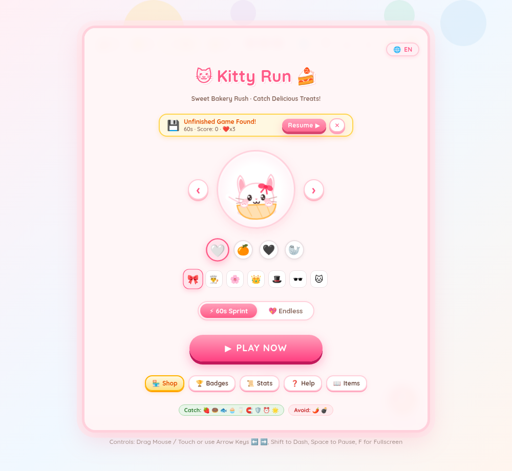

# 🐾 Kitty Run (萌喵甜点大作战) 🍰

> **GitHub Repository**: [kittyrun](https://github.com/footballqq/kittyrun)  
> A sweet, cozy, and ultra-cute HTML5 arcade game. Responsive across **4K/2K High-Res PC screens, iPad tablets, and mobile devices**, featuring pure procedural vector rendering and procedural Web Audio synthesis with **zero external image or audio asset dependencies**!



---

## 🎨 Highlights & Core Features

- **🌐 Full Bilingual Localization (English & 中文)**:
  - **Default English** for global players with a one-click header / start-screen toggle to switch seamlessly between English and Chinese (`'en'` / `'zh'`).
  - All HUD pills, game mode descriptions, shop items, accessories, floating in-game text, toasts, achievements, and share posters are dynamically translated on the fly.
- **✨ Visual-First Hero Stage & Clean Start Screen (Zero Clutter & Zero Scrollbars)**:
  - **No more walls of text**: Say goodbye to crowded text buttons! Breeds are displayed with cute circular visual avatars (`🤍` Marshmallow White, `🍊` Sunny Ginger, `🖤` Tuxedo Black, `🦭` Zen Capybara).
  - Players can understand and play instantly without reading a word ("不看文字就会玩").
  - Flanking `‹` and `›` arrow buttons let you cycle mascot skins smoothly with interactive live preview.
  - Compact accessory bubble buttons (`🎀`, `👨‍🍳`, `🌸`, `👑`, `🎩`, `🕶️`, `🐱`).
  - Sleek segmented mode pill `[ ⚡ 60s Sprint ] [ 💖 Endless ]` and big bouncy candy `PLAY NOW` button.
  - The entire screen fits on one page with spacious padding and zero scrollbars!
- **⏱️ Dual Game Modes**:
  - **⚡ 60s Sprint Challenge (Recommended)**: 1-minute high-speed rush! Grab as many sweets as possible before the timer runs out. Catch ⏰ Pocket Watches to gain **+5s bonus time**!
  - **💖 Classic Endless Survival**: Infinite endurance run with 3 Hearts. Keep catching treats and dodging hazards to beat records!
- **💾 LocalStorage Save & Resume (Play Anywhere, Anytime)**:
  - Need to leave mid-run? Pause and hit `💾 Save Progress` to safely store your current score, lives, combo, timer, buffs, and cat outfits into local storage.
  - When returning, the start screen automatically displays a compact resume banner to jump straight back into the run!
- **🎁 Sky-Drop Mystery Boutique**:
  - Parachute boutique boxes slowly float down from the sky as you rack up points. Catch them to unlock the shop mid-game with +25 bonus coins!
- **🏪 Boutique & Cat Wardrobe**:
  - Earn Sweet Coins by catching treats, achieving combos, and grabbing stars.
  - Unlock new breeds, hats, ribbons, and emergency supplies (Heart Herbs & Rainbow Shields).
- **📜 Local Career Records & Stats**:
  - Tracks total games, total sweets caught, best scores for both modes, and a log of recent matches.
- **🏳️ Early Settle Cash-In**:
  - In Endless mode, if you are satisfied with your score, you can settle early via the pause menu or header button to cash in your victory without forcing an intentional defeat.
- **🚨 Double Hazard Warning**:
  - 🌶️ Devil Chilis and 💣 Bombs feature glowing pulsating hazard rings and bouncing warning signs for crisp readability.
- **🔥 Combo Streaks & Drop Penalty**:
  - Consecutive catches increase your combo score multiplier up to 2.5x with milestone rewards at 5, 10, 15, and 20 combos.
  - Dropping any sweet immediately resets your combo streak!
- **💨 Dash Ability**:
  - Press <kbd>Shift</kbd>, double-tap the screen, or press the Dash button for an instant speed burst.
- **🖼️ Share Poster Generator**:
  - Generate cute commemorative posters with your mascot, score, combo rank, and timestamp to download as PNG or copy share text to clipboard!

---

## 🎮 操作方式

| 操作方式 | 控制说明 |
| :--- | :--- |
| **鼠标移动** | 在画布内左右移动或拖拽，猫咪灵动跟随 |
| **触控滑动** | 手机/平板指尖按住左右拖动猫咪 |
| **键盘左右键** | <kbd>⬅️</kbd> / <kbd>➡️</kbd> 或 <kbd>A</kbd> / <kbd>D</kbd> 控制猫咪左右横移 |
| **疾跑冲刺** | 按 <kbd>Shift</kbd> 键、双击屏幕 或点击右下角 `💨 冲刺` 按钮 |
| **全屏切换** | 按 <kbd>F</kbd> 键或点击右上角 `⛶` 按钮 |
| **道具图鉴** | 点击右上角 `📖` 按钮查看图例说明 |
| **暂停 / 继续** | 按 <kbd>Space</kbd>（空格键）或点击右上角 `⏸️` 按钮 |
| **静音切换** | 按 <kbd>M</kbd> 键或点击右上角 `🔔` 按钮 |

---

## 🚀 本地运行与端口指定方式

### 方式一：直接在浏览器中打开（最简易）
直接在文件管理器中双击打开 `index.html`，或用 Chrome / Edge / Firefox / Safari 等任意现代浏览器打开即可游玩。

### 方式二：使用配套 Python 本地服务器（支持自定义端口）
当前目录已内置功能完善的 `server.py`，支持多种端口指定方式：

```bash
# 1. 默认启动在 8080 端口（若被占用会自动安全顺延至 8081+）
python3 server.py

# 2. 方式 A：直接输入端口号（位置参数，最推荐）
python3 server.py 9000

# 3. 方式 B：使用 -p / --port 命令行选项
python3 server.py -p 3000
python3 server.py --port 8888

# 4. 方式 C：通过环境变量指定端口
PORT=7777 python3 server.py

# 5. 附加选项：启动后自动在浏览器中打开页面
python3 server.py 9000 -o

# 6. 查看全部参数帮助
python3 server.py --help
```

### 方式三：使用 Python 官方标准库模块
```bash
python3 -m http.server 9000
```
然后在浏览器中访问服务输出的地址（如 `http://localhost:9000`）即可畅玩！

---

## 📁 文件结构

- `index.html`：游戏主页面结构、HUD 仪表盘、Buff 状态栏、衣橱换装面板、图鉴与海报弹窗。
- `style.css`：马卡龙粉彩主题样式、全屏适配、果冻按钮动画、Toast 通知动效。
- `i18n.js`：中英双语多语言系统字典与动态切换引擎（默认英语）。
- `game.js`：游戏核心引擎、多端自适应、11种道具物理碰撞、危险警示、海报生成器。
- `audio.js`：Web Audio API 纯程序合成音效系统与八音盒背景旋律。
- `server.py`：支持端口自定义与自动容灾的本地 Python HTTP 服务器。
- `DEVELOPMENT.md`：面向开发者的完整架构设计、系统实现细节与二次开发指南。
- `README.md`：玩法与运行指引文档。

---

## 🛠️ 开发者指南

如需了解游戏底层架构（Canvas 矢量绘制算法、状态机、Web Audio 声音合成原理）、进行二次开发（增加新甜点、新增猫咪皮肤服饰、调节难度曲线）或进行生产环境部署，请参阅本地开发文档：
👉 **[DEVELOPMENT.md](DEVELOPMENT.md)**
